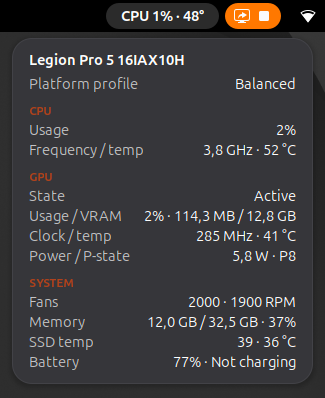

# Legion Stats

A GNOME Shell extension (GNOME 45–50) that puts one compact item in the top bar (`CPU 12% 53°`). Hovering it opens a card styled after Lenovo Legion Toolkit's tray tooltip:

- Platform profile (ACPI `platform_profile`)
- CPU: usage, average frequency, package temperature
- Discrete GPU: state, usage and VRAM, clock and temperature, power and P-state
- System: fans, memory, NVMe temperatures, battery

The card uses the shell theme (light, dark, high contrast and accent colour). Rows without a sensor are hidden. Numbers follow your locale.

- **Hover** the item to peek at the card.
- **Click** to keep it open. Click outside it, press Escape, or click the item again to close it.
- **Right click** for a menu with Settings.

## Install

From a release zip:

    gnome-extensions install --force legion-stats@beltra.github.io.shell-extension.zip

From git:

    git clone https://github.com/beltra/legion-stats-gnome
    cd legion-stats-gnome && make install

Then log out and back in (on Wayland the shell cannot load a new extension in place), and run `gnome-extensions enable legion-stats@beltra.github.io`. `make pack` builds the zip only.

Preferences:

- Top bar: update interval (default 3 s), and any combination of CPU usage, CPU temperature, GPU usage, GPU temperature and memory, shown as `CPU 12% 53° · GPU 4% 41° · RAM 37%`.
- Card: which sections to show.

## Supported hardware

| Item | Source | Tested |
|---|---|---|
| CPU usage | `/proc/stat` | yes |
| CPU temperature | hwmon `coretemp` "Package id", `k10temp`/`zenpower` "Tdie" or "Tctl", `cpu_thermal` | Intel only |
| CPU frequency | `/proc/cpuinfo` (x86), otherwise cpufreq policies | Intel only |
| Fans | every `fan*_input` outside GPU drivers (lenovo_wmi_other, thinkpad, dell_smm, asus, …) | Lenovo only |
| NVIDIA dGPU | `nvidia-smi` | yes |
| AMD / Intel dGPU | `gpu_busy_percent`, `mem_info_vram_*`, and the device's hwmon | no |
| Battery | every system battery in `/sys/class/power_supply` | single battery only |
| NVMe | hwmon `nvme` "Composite" | yes |

## Power use

- The top bar reads `/proc/stat` and one temperature file every 3 s through file handles kept open. It stops while the panel is hidden (fullscreen) or the screen is blanked. When the screen is locked the shell disables the extension.
- The card reads everything else every 2 s, and only while it is open. Reads run asynchronously because NVMe and ACPI battery reads can block for 10–60 ms.
- GPU values in the top bar are off by default. When enabled they are read every 10 s, which is longer than the usual 5 s runtime-PM autosuspend delay, and only while the dGPU is already awake; otherwise the bar shows `GPU off`. On NVIDIA each read starts `nvidia-smi` once (about 25 ms of CPU).
- The dGPU is queried only while its runtime PM status is `active`. One `nvidia-smi --loop-ms` process runs per hover and is killed when the card closes. Two limits: the status check and the moment nvidia-smi opens the device are a few ms apart, and if the GPU suspends in that gap nvidia-smi resumes it. While the card stays open, an already-active GPU cannot suspend.

Measured with a stubbed harness under `strace -c` (60 s, Legion Pro 5i):

| | before | after |
|---|---|---|
| bar: file opens/min | 63 | 0 (2 at start) |
| bar: I/O syscalls/min | ~420 | ~90 |
| bar: wakeups/min | 30 | 20 |
| card open: CPU time/min | 1.65 s | 0.38 s |
| card open: processes started/min | 60 | 1 per hover |

## Accuracy notes

- CPU usage is the busy share of the aggregate `cpu` line, like `top`: guest time is not double counted, and steal counts as busy. The first value appears after one interval.
- Frequency is the mean over online CPUs. On hybrid CPUs the E-cores pull it down.
- Memory used is `MemTotal − MemAvailable`, like `free` and htop. Sizes are in SI units (GB), as elsewhere in GNOME, so they read slightly higher than `free -h` (GiB).
- Battery power is shown only while charging or discharging, as an absolute value.
- Temperatures are in °C.

`tools/check-values.sh` prints the same readings from `top`, `sensors`, `free` and `nvidia-smi` so you can compare them with the card.

## License

GPL-2.0-or-later
